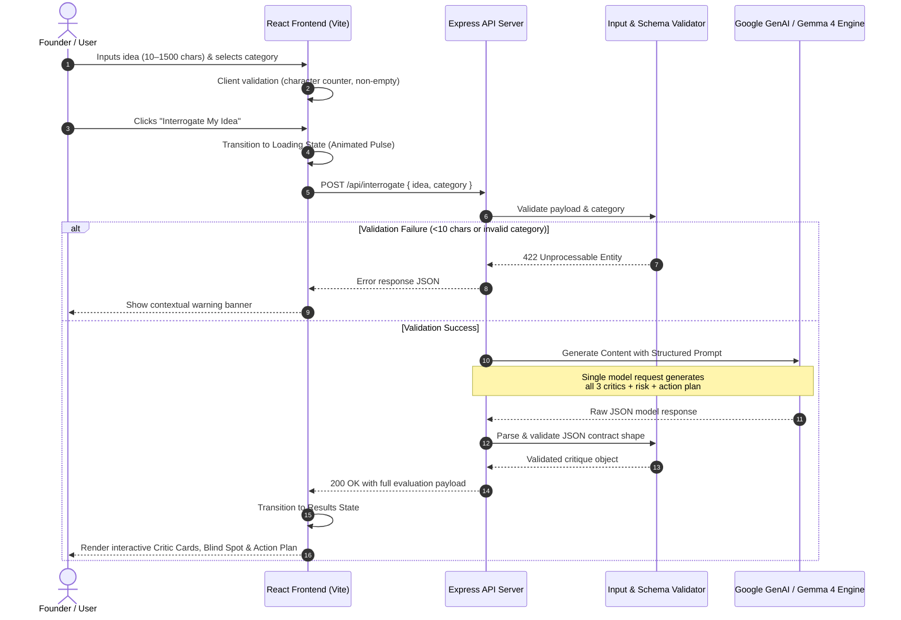
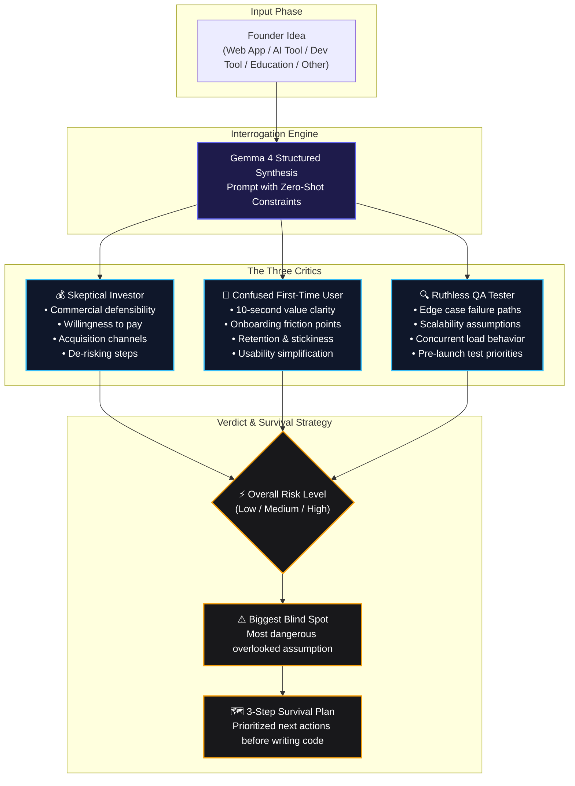

# ⚖️ Idea Interrogator

> **"Your idea is on trial. Can it survive the questions?"**

Stress-test any project or startup idea with three AI critics in a single pass:
- 💰 **Skeptical Investor** (Commercial viability & monetization)
- 👤 **Confused First-Time User** (Clarity, value proposition & onboarding)
- 🔍 **Ruthless QA Tester** (Edge cases, failure modes & technical risks)

---

## 🏛️ Interrogation Architecture & Workflow

### 1. End-to-End System Pipeline



---

### 2. The Interrogation Tribunal Framework



---

## 🎯 Key Features

- **Triad Critique in One Request**: Simultaneously queries three adversarial perspectives without three separate round trips, keeping latency low.
- **Strict Structured JSON**: Guaranteed JSON schema featuring verdicts, 3 hard interrogation questions per critic, core concerns, and concrete recommendations.
- **Synthesized Blind Spot & Action Plan**: Unearths the single biggest blind spot across all perspectives and outputs an actionable 3-step roadmap.
- **Secure Key Isolation**: API keys remain strictly confined to the backend server in `server/.env` and are never exposed to browser bundles.
- **Interactive High-Contrast UI**: Expandable cards, one-click demo presets, live character count validation, and resilient error recovery.

---

## 📊 Structured Response Contract

The backend expects and produces the following structured JSON contract:

```json
{
  "ideaTitle": "Short descriptive title (5 words max)",
  "summary": "One-sentence description of the idea",
  "critics": [
    {
      "id": "investor",
      "verdict": "Short verdict from a Skeptical Investor (1-2 sentences)",
      "questions": [
        "Hard commercial question 1",
        "Hard commercial question 2",
        "Hard commercial question 3"
      ],
      "biggestConcern": "The single biggest commercial or sustainability risk",
      "recommendation": "One concrete next step to de-risk this commercially"
    },
    {
      "id": "user",
      "verdict": "Short verdict from a Confused First-Time User (1-2 sentences)",
      "questions": [
        "Usability question 1",
        "Usability question 2",
        "Usability question 3"
      ],
      "biggestConcern": "The single biggest usability or clarity problem",
      "recommendation": "One concrete change that would make this immediately clearer"
    },
    {
      "id": "qa",
      "verdict": "Short verdict from a Ruthless QA Tester (1-2 sentences)",
      "questions": [
        "Edge case question 1",
        "Edge case question 2",
        "Edge case question 3"
      ],
      "biggestConcern": "The single riskiest technical assumption or failure mode",
      "recommendation": "One concrete thing to test or validate first"
    }
  ],
  "overallRisk": "Low | Medium | High",
  "biggestBlindSpot": "The most important overlooked weakness across all perspectives",
  "actionPlan": [
    "First action to take",
    "Second action to take",
    "Third action to take"
  ]
}
```

---

## 📂 Project Structure

```text
├── client/                      # Frontend application (React 19 + Vite)
│   ├── src/
│   │   ├── components/
│   │   │   └── CriticCard.jsx   # Expandable interactive critic component
│   │   ├── App.jsx              # Main state machine (Landing/Loading/Results/Error)
│   │   ├── App.css              # Custom responsive dark-theme design system
│   │   └── main.jsx             # React entry point
│   ├── index.html
│   ├── package.json
│   └── vite.config.js           # Includes dev proxy to Express API
├── server/                      # Backend application (Node.js + Express)
│   ├── index.js                 # API route, schema validation, prompt & AI client
│   ├── package.json
│   └── .env                     # Private environment variables (API Key)
├── .env.example                 # Template for required environment variables
├── Agents.md                    # Project requirements and constraint spec
└── README.md                    # System documentation and architectural diagrams
```

---

## ⚡ Quick Start

### Prerequisites
- [Node.js](https://nodejs.org/) (v18.0.0 or higher)
- npm or pnpm

### 1. Environment Setup

Create a `.env` file in the `server` directory:

```bash
# On Windows PowerShell:
Copy-Item .env.example server\.env

# On macOS/Linux:
cp .env.example server/.env
```

Open `server/.env` and insert your API key:
```env
GEMINI_API_KEY=your_gemini_or_gemma_api_key_here
PORT=3001
```

### 2. Install Dependencies

In two separate terminals:

```bash
# Terminal 1: Backend
cd server
npm install

# Terminal 2: Frontend
cd client
npm install
```

### 3. Run the Application

```bash
# Terminal 1: Start Backend
cd server
npm start
# Server listens at http://localhost:3001

# Terminal 2: Start Frontend
cd client
npm run dev
# App opens at http://localhost:5173
```

---

## 🛡️ Safety & AI Disclaimer

- **Hypothesis, Not Fact**: All critiques, risk ratings, and recommendations are algorithmic hypotheses designed to prompt critical thinking, not legal, financial, or engineering guarantees.
- **Safety Filtering**: The backend sets `BLOCK_NONE` thresholds specifically to allow rigorous adversarial business critiques without accidental false-positive safety triggers.
